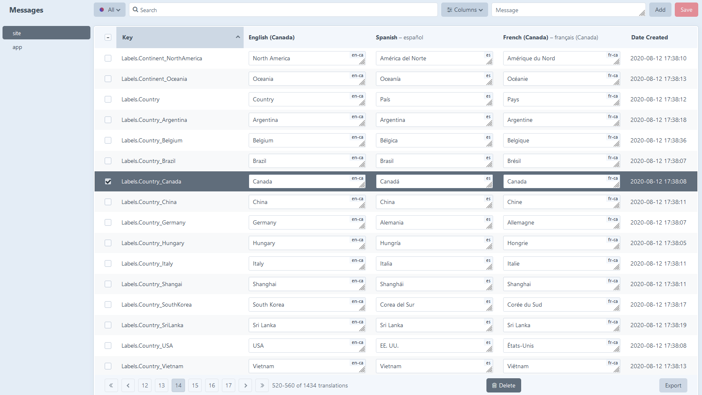

# Translations admin plugin for Craft CMS

This plugins adds a control panel interface for your clients to edit your static translations for each language side by side.



## Features

- Add, edit or delete translations in the Control Panel with each language side by side.

- Choose a category, filter by missing translations, search by keywords and sort by key/date.

- Export all or a subset of your translations to a CSV file and import it back after translators worked on it.

- Translations will be kept inside your database instead of PHP files for a better workflow.

- Optionally, missing translations are automatically added to the database when a page is visited.

- Ability to parse your twig templates or migrate from your existing PHP translations (and export it back to PHP files).

- GraphQL support to query your translations.

## Requirements

This plugin requires Craft CMS 5.6.0 or later and PHP 8.2 or later.

## Installation

Install the plugin via the **Plugin Store** or by command line:
```
composer require mutation/translate
php craft install/plugin translations-admin
```

You can now edit your translations in the control panel `/admin/translations-admin`.

## Permissions

Users need the **Access Translations** permission (named after the **Plugin Name** setting) to see the translations. You also have special permissions for the Translations admin plugin:
- Save translations
- Add translations
- Delete translations
- Export translations
- Import translations
- Use translations utilities
- Change translations settings

## Settings

You can either go the **settings page** or create a file `translations-admin.php` in your `config` directory.

- **Plugin Name**: How the plugin should be named in the CP
- **Source Language**: By default, the plugin uses the primary site for the source language, but you can override it with this setting.
- **Categories**: Choose the source message categories you want to have in your database and control panel. Don't add the categories of Craft and plugins (e.g. `app`, `yii` or a plugin handle): their translations would then only come from the database, and the control panel would lose its own translations.
- **Add missing translations**: Controls whether missing translations are automatically added to the database when a page is visited.
- **Add missing translations for site request only**: Controls whether missing translations are only added when the request is from the site.
- **Add missing translations from templates only**: Controls whether missing translations are only added when they are translated in a template with the `t` filter (disabled by default). When disabled, the messages translated in PHP code are also added, including the names Craft translates itself in the `site` category (e.g. sites, sections and fields).
- **Enable caching**: Controls whether the translations are cached (disabled by default). The cache is cleared automatically when translations are changed with the plugin. If they are changed another way (e.g. by importing a database), clear the data caches.
- **Excluded Messages**: Messages that should not be added to the database, identified by a part of the string (basic matching, no regex — see example).
- **Template paths** (config file only): Other directories parsed by the "Parse templates" utility, besides the site templates. Aliases are supported (e.g. `@root/modules/templates`). The paths that aren't directories are skipped, with a warning in the logs.

Config file example:
```PHP
<?php

return [
    'pluginName' => 'Translations',
    'sourceLanguage' => 'en',
    'categories' => [
        'site',
        'emails'
    ],
    'addMissingTranslations' => false,
    'addMissingSiteRequestOnly' => false,
    'addMissingFromTemplatesOnly' => true,
    'enableCaching' => false,
    'excludedMessages' => [
        'Submission triggered for',
        'Submission marked as spam'
    ],
    'templatePaths' => [
        '@root/modules/templates'
    ]
];
```

## Import and export

The exported CSV files have the key in the first column, followed by a column for each language, with the language ID as the header (e.g. `fr-CA`). The files are imported back by matching the headers to the site languages, so the order of the columns doesn't matter. A header can be the language ID (`fr-CA`), the language alone when only one site uses it (`fr`), or the language name (`French (Canada)` or `français (Canada)`, used by the files exported with previous versions). The other columns are ignored and listed after the import, and a file without any language column is rejected.

Files saved by spreadsheet apps can be imported as is (`.csv`, `.tsv` or `.txt`): the delimiter (comma, semicolon or tab) and the encoding (UTF-8, UTF-16 or Windows-1252) are detected automatically. An empty cell clears the translation, and when a key is in the file more than once, its last row wins.

Values starting with `=`, `+`, `-`, `@`, a tab or a carriage return are prefixed with a single quote in the exported files to prevent spreadsheet apps from running them as formulas. The quote is removed when the file is imported.

## Console commands

```
php craft translations-admin/utilities/missing  # Parse the site templates to add the missing translations to the database
php craft translations-admin/utilities/import   # Import PHP translations to the database
php craft translations-admin/utilities/export   # Export database translations to PHP files
php craft translations-admin/utilities/delete   # Delete all database translations (use --interactive=0 to skip the confirmation)
```

## GraphQL

Query static messages this way:
```GRAPHQL
{
  staticMessages(language:["en-CA", "fr-CA"], category: ["site", "emails"]) {
    key
    message
    language
    category
    dateCreated
  }
}
```

## Events

You can use these custom events in your plugin or module to do any actions after translations are added, saved or deleted (example: empty the cache):
```PHP
use mutation\translate\services\MessagesService;

Event::on(MessagesService::class, MessagesService::EVENT_AFTER_SAVE_MESSAGES, function (Event $e) { ... });
Event::on(MessagesService::class, MessagesService::EVENT_AFTER_ADD_MESSAGE, function (Event $e) { ... });
Event::on(MessagesService::class, MessagesService::EVENT_AFTER_DELETE_MESSAGES, function (Event $e) { ... });
```

## Methods

You can create a new translation programmatically (in migrations or otherwise):
```PHP
use mutation\translate\Translate as TranslatePlugin;
...
TranslatePlugin::getInstance()->messages->addMessage("Lorem ipsum", "site");
```
The second parameter is the category (site, emails, etc.)

## Tests

The tests use [Codeception](https://codeception.com/) with the [Craft test framework](https://craftcms.com/docs/4.x/testing/) (only documented for Craft 4). They install Craft and the plugin in a database that is **emptied on every run**.

With [DDEV](https://ddev.com/), the project's own database is used:
```
ddev start
ddev composer install
ddev composer test
```

Without DDEV, copy `tests/.env.example` to `tests/.env`, point it to an empty MySQL, MariaDB or PostgreSQL database, then run `composer test`.

The tests run on GitHub Actions for the pushes to `master` and the pull requests, with PHP 8.2 and 8.4 on MySQL, MariaDB and PostgreSQL.
